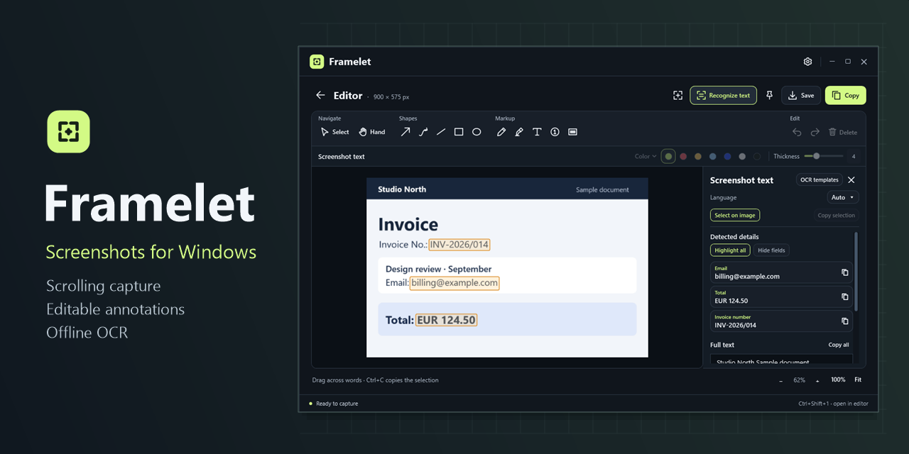
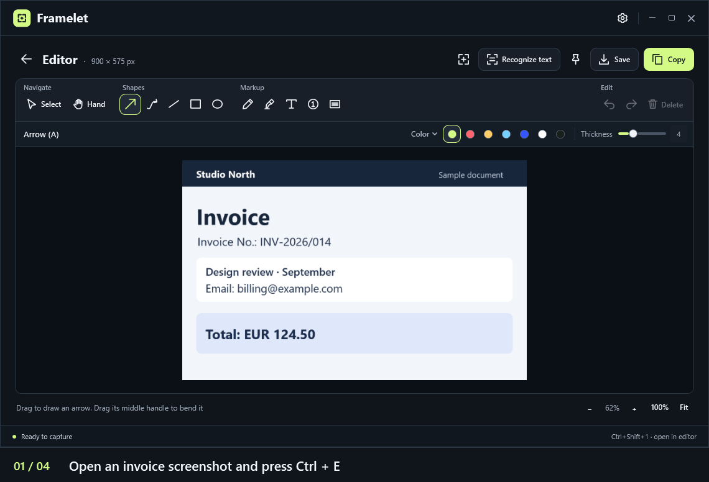
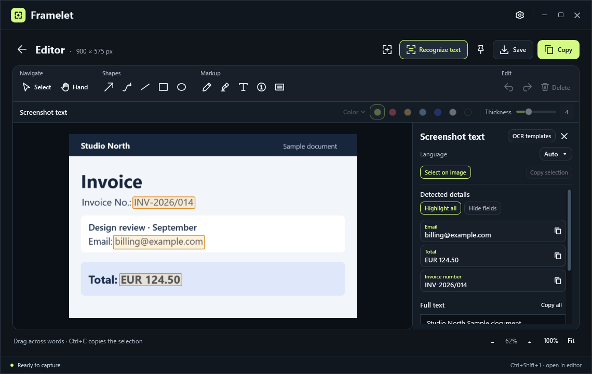

<p align="center">
  <strong>English</strong> · <a href="README.ru.md">Русский</a>
</p>

<p align="center">
  
</p>

<p align="center">
  <strong>Capture an entire page. Copy text straight from the image.</strong>
</p>

<p align="center">
  <strong><a href="https://github.com/SerzLV/Framelet/releases/latest/download/Framelet.exe">Download EXE for Windows x64</a></strong>
  · <a href="https://github.com/SerzLV/Framelet/releases/latest/download/Framelet-win-x64.zip">ZIP</a>
  · <a href="https://github.com/SerzLV/Framelet/releases/latest">Release notes</a>
</p>

<p align="center">
  <a href="#see-it-in-action">Watch the demo</a> · <a href="#quick-start">Quick start</a>
  · <a href="#keyboard-shortcuts">Shortcuts</a> · <a href="#support">Support</a>
</p>

Framelet is a portable Windows screenshot tool with editable annotations and offline OCR. The EXE includes the .NET Desktop Runtime.

## See it in action

The demo uses a fictional invoice. Framelet recognizes the invoice number, total, and email, highlights their locations on the image, and covers just the email before sharing.



## Quick start

| To | Do this |
| --- | --- |
| Copy a region | Press `Print Screen`, select an area, and press `Enter` or `Ctrl+C`. |
| Open a new capture in the editor | Press `Ctrl+Shift+1` and select the area. |
| Copy text from an image | In the editor, press `Ctrl+E`, select words on the image, and press `Ctrl+C`. |
| Reopen your latest capture | Press `Ctrl+Shift+5`. |

## Examples

### Show exactly where a bug happens

Open the capture in the editor. Use a curved arrow to point at the control, numbered markers to show the order of actions, and an inline text annotation for the expected result. You can select an existing annotation and move it or change its color and thickness. Copy the finished image into the issue.

### Pull an invoice number out of a screenshot

Press `Ctrl+E` and click a detected value to copy it. Set up an **OCR template** called **Invoice number** with the labels `Invoice No.` and `Rēķina Nr.` on separate lines. Select **Code** as the format and test the rule on the current image. Use **Hide fields** to cover an email or another field before sending the screenshot.

### Share a page that doesn't fit on screen

Press `Ctrl+Shift+4`, select the page area, and start **Auto-scroll**. Framelet joins the frames into one image. For an app that changes screens with the Down key, choose **Whole frames (↓)**. [Scrolling capture instructions](#capture-a-long-page)

### Find an old screenshot by what it says

Type a phrase you remember into history search, such as `Design review`. Framelet searches filenames and recognized text. Open a result to continue editing, or select several to recycle in one action.

## Features

| Feature | What you can do |
| --- | --- |
| **Screen capture** | Capture a region, the monitor under the pointer, or the active window. Use delayed capture or stitch together a long page with automatic or manual scrolling. |
| **Editor** | Add curved arrows, lines, circles, rectangles, text, and numbered markers. Select existing annotations to move them or change their color and thickness. Crop, zoom with the mouse wheel, and pan with the Hand tool. |
| **Text recognition** | Select and copy words directly from the screenshot. Auto OCR uses English, Latvian, and Russian by default. Choose a language in the editor or install more and customize Auto under **Settings → OCR**. Installed languages work offline. |
| **Detected fields** | Locate and copy recognized contact details, names, IBANs, and amounts. Use **Hide fields** to choose which categories to cover before exporting. |
| **Screenshot history** | Search by name or recognized text, rename or copy an entry, and recycle groups of screenshots. Reopen saved screenshots with editable annotations and up to ten undo steps. |
| **System tray** | Start Framelet with Windows, capture from the tray, and reopen the latest screenshot. Set a shortcut to show or hide Framelet. The app remembers your language, window size, and four most recent annotation colors. |

The interface is available in English and Russian. OCR language settings are separate. Russian, Latvian, and English are built in, and the catalog offers 123 language models. Install additional models once to use them offline and select which ones Auto uses together. [Framelet 1.2.0 release notes](https://github.com/SerzLV/Framelet/releases/tag/v1.2.0)

<details>
<summary>Editor and history screenshots</summary>




</details>

## Keyboard shortcuts

The table shows the defaults. Change the global capture shortcuts and the shortcut for opening the last screenshot in **Settings**.

Framelet uses a Windows keyboard hook to handle plain `Print Screen` while the app is in the tray. The hook starts region capture and can be disabled in **Settings**. Scrolling capture sends mouse-wheel input or the Down key, depending on the mode.

| Shortcut | Action |
| --- | --- |
| `Print Screen` | Copy a selected region to the clipboard |
| `Ctrl + Shift + 1` | Select a region and open it in the editor |
| `Ctrl + Shift + 2` | Capture the monitor under the pointer |
| `Ctrl + Shift + 3` | Capture the active window |
| `Ctrl + Shift + 4` | Start scrolling capture, add a frame, or stop auto-scroll |
| `Ctrl + Shift + 5` | Open the latest screenshot in the editor |
| `Ctrl + Alt + F10` | Show Framelet or hide it in the tray. Change this shortcut in Settings |
| `Ctrl + E` | Recognize and copy text in quick capture. In the full editor, recognize text and enable selection on the image |
| `Ctrl + V` | Open an image from the clipboard |
| `Ctrl + C` / `Ctrl + S` | Copy or save the annotated screenshot. In text selection mode, `Ctrl + C` copies the selected text |
| `Ctrl + Z` / `Ctrl + Y` | Undo or redo a change |

<details>
<summary>Editor tools</summary>

| Key | Action |
| --- | --- |
| `S` / `Delete` | Select an annotation or delete the selected one |
| `O` | Draw an ellipse. Hold `Shift` to draw a circle |
| `V` | Draw a curved arrow with two control points |
| `L` / `A` | Draw a line or arrow with one bend point |
| `R` / `P` / `M` | Draw a rectangle, use the pen, or highlight with the marker |
| `T` / `N` / `B` | Add text, place a numbered marker, or redact an area |
| `F2` | Edit the selected text. You can also double-click text with the Select tool |
| `Enter` / `Shift + Enter` / `Esc` | While typing an annotation, confirm, insert a new line, or cancel. Confirming an empty existing annotation removes it |
| `C` | Crop. Press `Enter` to apply or `Esc` to cancel |
| `H` | Switch to the Hand tool to pan around a zoomed screenshot |
| Mouse wheel | Zoom around the pointer |

</details>

## Capture a long page

1. Open the page and press `Ctrl + Shift + 4`.
2. Select the scrolling area on one monitor, leaving out fixed bars and the scrollbar. Press `Enter` to capture the first frame.
3. Click **Auto-scroll** and let the page reach the bottom, or click **Stop** when you have enough. Drag the panel by its title to move it. Scrolling resumes when you release it.
4. At the bottom of a page in Edge, Framelet can include visible content below your selection automatically. Use **Adjust bottom** to trim it, or **Extend bottom** if Framelet asks you to choose the edge.
5. Click **Open screenshot** to inspect the stitched image and add annotations.

To capture manually, scroll down a little at a time and click **Add frame**.

For apps that advance one screen at a time when you press `↓`, enable **Whole frames (↓)** before starting auto-scroll. If Framelet detects two small scrolling shifts, choose **Use scrolling capture** to stitch the buffered frames or **Keep whole frames** to continue capturing each screen in full.

## Recognize and cover fields

Press `Ctrl+E` in the editor. Click a detected field to copy it, hover over it to locate it on the image, or choose **Highlight all**. Use **Hide fields** to choose what to cover, then click **Cover selected fields**. Review the result before sharing. With history enabled, the original remains in the local edit journal.

Open **Settings → OCR templates** or **OCR templates** in the editor to define a rule. Enter the labels you expect to see, one per line, and choose where to look for the value and its format. Use **Test on screenshot** after running OCR to preview matches. The IBAN template format extracts the printed value. Built-in detection checks the length and checksum for the countries it supports.

## Manage screenshot history

Click **Select** in the history header or use one of these gestures to start a selection.

| Gesture | Action |
| --- | --- |
| Mouse drag | Select every card touched by the rectangle. Keep dragging near the edge to scroll the list |
| `Ctrl` + click | Add or remove one screenshot. Hold `Ctrl` while dragging to toggle the cards you cross |
| `Shift` + click | Select the range from the previous selection point, including cards on other rows |
| `Ctrl + A` | In selection mode, select all screenshots in the current results. In the search field, select the search text |
| `Delete` | Confirm moving the selected screenshots to the Recycle Bin. **Delete selected** does the same thing |

Changing the search preserves selected screenshots that still match. Use **Done** to leave selection mode.

## Screenshot storage

Choose where to save PNGs in Settings. The default folder is `%LOCALAPPDATA%\Framelet\History`. Framelet includes screenshots from previously selected folders in its history. You can turn off automatic saving and still reopen your most recent capture until you quit.

The history list has no item limit. Framelet loads thumbnails as you scroll. Clearing history keeps the saved PNGs in your folders and clears the edit history and OCR index for those entries. The Recycle Bin restores the finished PNG. History search caches recognized text locally in Framelet's application data folder.

Framelet checks for orphaned edit journals when it loads the history.

Framelet keeps the original images and edit history for edited screenshots in `%LOCALAPPDATA%\Framelet\Edits`. The clipboard and exported PNG contain the finished image with your crops and annotations applied.

## Build from source

From the repository root on Windows with the .NET 10 SDK, run the release script to create `Framelet.exe`, `Framelet-win-x64.zip` with licenses, and `SHA256SUMS.txt` in `publish`.

```powershell
powershell -NoProfile -ExecutionPolicy RemoteSigned -File .\scripts\Build-Release.ps1
```

Run `publish\Framelet.exe`. The executable includes the .NET Desktop Runtime and OCR models. Closing the window keeps Framelet in the notification area. To exit, right-click the tray icon and select **Quit**.

If the OCR module fails to load, install the [Microsoft Visual C++ Redistributable x64](https://learn.microsoft.com/en-us/cpp/windows/latest-supported-vc-redist).

The published EXE is unsigned, so Windows SmartScreen may show a warning. Verify the download source and compare its SHA-256 hash with `SHA256SUMS.txt` in the release. [Microsoft SmartScreen documentation](https://learn.microsoft.com/windows/apps/package-and-deploy/smartscreen-reputation)

Run the regression checks on Windows with the .NET 10 SDK.

```powershell
dotnet run -c Release --project tests/Framelet.Regression
```

## How Framelet works

The [WPF app and its resources](src/Framelet) are in `src/Framelet`. Open `Framelet.slnx` to work with the application and its regression tests together.

Framelet is written in C# and WPF. `CaptureService` handles screen capture, `ScrollStitcher` joins scrolling frames, and `OcrService` recognizes text. `HistoryStore` saves screenshots, preferences, and edit history.

OCR uses [Tesseract](https://github.com/charlesw/tesseract) and [tessdata_fast 4.1.0](https://github.com/tesseract-ocr/tessdata_fast/releases/tag/4.1.0) models under the [Apache 2.0 license](src/Framelet/Assets/Ocr/LICENSE). Framelet parses phone numbers with [libphonenumber-csharp](https://www.nuget.org/packages/libphonenumber-csharp/9.0.43) using the Windows region setting.

## License

Framelet is available under the Apache License 2.0. See [LICENSE](LICENSE) and [third-party notices](THIRD-PARTY-NOTICES.md).

## Support

If Framelet helps with your work, you can support its development on Buy Me a Coffee.

[](https://buymeacoffee.com/serzlv)
