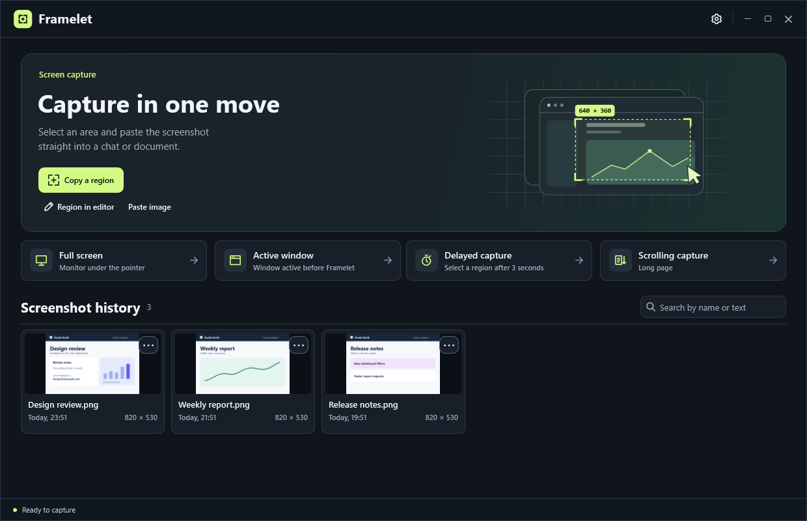

# Framelet

**English** · [Русский](README.ru.md)

[](https://buymeacoffee.com/serzlv)

**Capture screenshots, add annotations, and copy text from images on Windows.**

Press `Print Screen`, select an area, and paste the screenshot straight into a chat or document. Open the editor to point out a detail with a curved arrow, select text directly on the image, or cover contact details before sharing.


## Features

| Feature | What you can do |
| --- | --- |
| **Screen capture** | Capture a region, the monitor under the pointer, or the active window. Use delayed capture or stitch together a long page with automatic or manual scrolling. |
| **Editor** | Add curved arrows, lines, circles, rectangles, text, and numbered markers. Select existing annotations to move them or change their color and thickness. Crop, zoom with the mouse wheel, and pan with the Hand tool. |
| **Text recognition** | Select and copy words directly from the screenshot. OCR runs locally and recognizes English, Latvian, and Russian. Auto mode can read all three languages in one image. |
| **Contact details** | Copy detected email addresses, phone numbers, postal addresses, and links individually. Use **Hide contact details** to cover detected emails, phone numbers, and addresses before exporting. |
| **Screenshot history** | Search all saved screenshots by name or recognized text. Rename, copy, or recycle an entry. Reopen saved screenshots with editable annotations and up to ten undo steps. |
| **System tray** | Start Framelet with Windows, capture from the tray, and reopen the latest screenshot. Set a shortcut to show or hide Framelet. The app remembers your language, window size, and four most recent annotation colors. |

The interface is available in English and Russian. Switch languages in Settings.

<details>
<summary>Home screen and screenshot history</summary>



</details>

## Keyboard shortcuts

The table shows the defaults. Change the global capture shortcuts and the shortcut for opening the last screenshot in **Settings**.

| Shortcut | Action |
| --- | --- |
| `Print Screen` | Copy a selected region to the clipboard |
| `Ctrl + Shift + 1` | Select a region and open it in the editor |
| `Ctrl + Shift + 2` | Capture the monitor under the pointer |
| `Ctrl + Shift + 3` | Capture the active window |
| `Ctrl + Shift + 4` | Start scrolling capture, add a frame, or stop auto-scroll |
| `Ctrl + Shift + 5` | Open the latest screenshot in the editor |
| `Ctrl + Alt + F10` | Show Framelet or hide it in the tray. Change this shortcut in Settings |
| `Ctrl + E` | Recognize text and enable text selection on the image |
| `Ctrl + V` | Open an image from the clipboard |
| `Ctrl + C` / `Ctrl + S` | Copy or save the annotated screenshot. In text selection mode, `Ctrl + C` copies the selected text |
| `Ctrl + Z` / `Ctrl + Y` | Undo or redo a change |

<details>
<summary>Editor tools</summary>

| Key | Action |
| --- | --- |
| `S` / `Delete` | Select an annotation or delete the selected one |
| `O` | Draw an ellipse. Hold `Shift` to draw a circle |
| `V` | Draw a curved arrow with two control points |
| `L` / `A` | Draw a line or arrow with one bend point |
| `R` / `P` / `M` | Draw a rectangle, use the pen, or highlight with the marker |
| `T` / `N` / `B` | Add text, place a numbered marker, or redact an area |
| `F2` | Edit the selected text. You can also double-click text with the Select tool |
| `C` | Crop. Press `Enter` to apply or `Esc` to cancel |
| `H` | Switch to the Hand tool to pan around a zoomed screenshot |
| Mouse wheel | Zoom around the pointer |

</details>

## Capture a long page

1. Open the page and press `Ctrl + Shift + 4`.
2. Select the part of the page that scrolls, leaving out fixed bars and the scrollbar. Framelet captures the first frame immediately.
3. Click **Auto-scroll** and let the page reach the bottom, or click **Stop** when you have enough. Drag the panel by its title to move it. Scrolling resumes when you release it.
4. At the bottom of a page in Edge, Framelet can include visible content below your selection automatically. Use **Adjust bottom** to trim it, or **Extend bottom** if Framelet asks you to choose the edge.
5. Click **Open screenshot** to inspect the stitched image and add annotations.

To capture manually, scroll down a little at a time and click **Add frame**.

## Screenshot storage

Choose where to save PNGs in Settings. The default folder is `%LOCALAPPDATA%\Framelet\History`. Framelet includes screenshots from previously selected folders in its history. You can turn off automatic saving and still reopen your most recent capture until you quit.

The history list has no item limit. Framelet loads thumbnails as you scroll. Clearing history keeps the saved PNGs in your folders and clears the edit history and OCR index for those entries. The Recycle Bin restores the finished PNG. History search caches recognized text locally in Framelet's application data folder.

Framelet keeps the original images and edit history for edited screenshots in `%LOCALAPPDATA%\Framelet\Edits`. The clipboard and exported PNG contain the finished image with your crops and annotations applied.

## Build from source

Build on Windows with the .NET 10 SDK. Run these commands from the repository root.

```powershell
dotnet build -c Release
dotnet publish -c Release -r win-x64 `
  --self-contained true `
  -p:PublishSingleFile=true `
  -p:IncludeNativeLibrariesForSelfExtract=true `
  -p:DebugType=None -o publish
```

Run `publish\Framelet.exe`. The executable includes the .NET Desktop Runtime and OCR models. Closing the window keeps Framelet in the notification area. To exit, right-click the tray icon and select **Quit**.

If the OCR module fails to load, install the [Microsoft Visual C++ Redistributable x64](https://learn.microsoft.com/en-us/cpp/windows/latest-supported-vc-redist).

Run the regression checks on Windows with the .NET 10 SDK.

```powershell
dotnet run -c Release --project tests/Framelet.Regression
```

## How Framelet works

Framelet is written in C# and WPF. `CaptureService` handles screen capture, `ScrollStitcher` joins scrolling frames, and `OcrService` recognizes text. `HistoryStore` saves screenshots, preferences, and edit history.

OCR uses [Tesseract](https://github.com/charlesw/tesseract) and [tessdata_fast 4.1.0](https://github.com/tesseract-ocr/tessdata_fast/releases/tag/4.1.0) models under the [Apache 2.0 license](Assets/Ocr/LICENSE). Framelet parses phone numbers with [libphonenumber-csharp](https://www.nuget.org/packages/libphonenumber-csharp/9.0.43) using the Windows region setting.

## License

Framelet is available under the Apache License 2.0. See [LICENSE](LICENSE) and [third-party notices](THIRD-PARTY-NOTICES.md).
