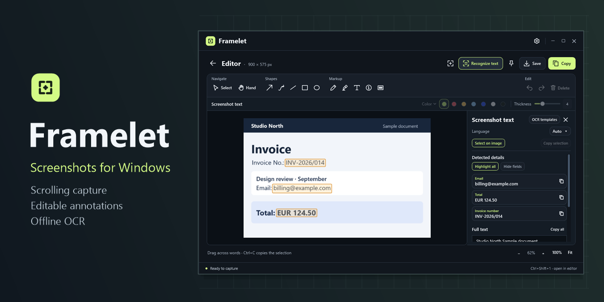
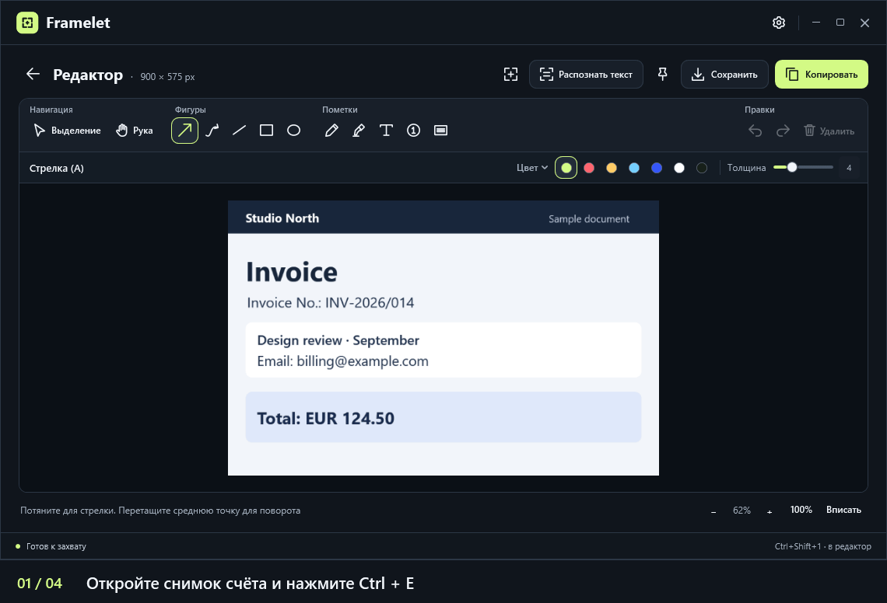
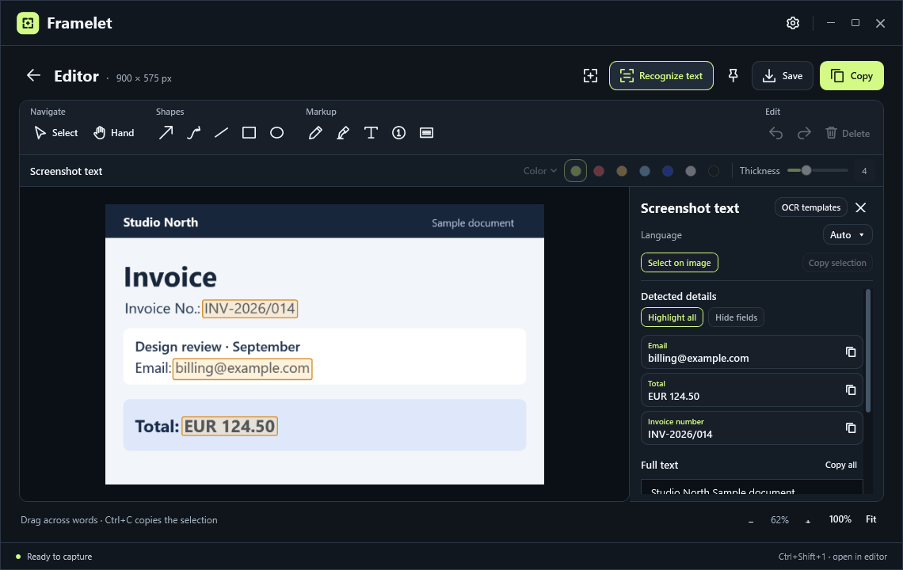
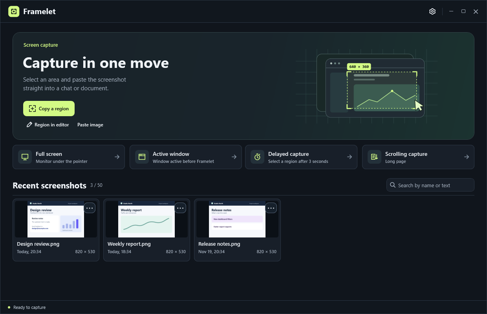

<p align="center">
  <a href="README.md">English</a> · <strong>Русский</strong>
</p>

<p align="center">
  
</p>

<p align="center">
  <strong>Снимите страницу целиком. Скопируйте текст прямо с изображения.</strong>
</p>

<p align="center">
  <strong><a href="https://github.com/SerzLV/Framelet/releases/latest/download/Framelet.exe">Скачать EXE для Windows x64</a></strong>
  · <a href="https://github.com/SerzLV/Framelet/releases/latest/download/Framelet-win-x64.zip">ZIP</a>
  · <a href="https://github.com/SerzLV/Framelet/releases/latest">Описание релиза</a>
</p>

<p align="center">
  <a href="#демонстрация">Смотреть демо</a> · <a href="#быстрый-старт">Быстрый старт</a>
  · <a href="#горячие-клавиши">Горячие клавиши</a> · <a href="#поддержать-framelet">Поддержать</a>
</p>

Framelet — портативное приложение для скриншотов с редактируемыми пометками и офлайн-распознаванием текста. Среда .NET Desktop Runtime уже включена в EXE.

## Демонстрация

На вымышленном счёте Framelet находит номер, сумму и email, подсвечивает их на изображении и закрашивает только email перед отправкой.



## Быстрый старт

| Что нужно | Как сделать |
| --- | --- |
| Скопировать область | Нажмите `Print Screen`, выделите область и нажмите `Enter` или `Ctrl+C`. |
| Открыть новый снимок в редакторе | Нажмите `Ctrl+Shift+1` и выделите область. |
| Скопировать текст с изображения | В редакторе нажмите `Ctrl+E`, выделите слова прямо на снимке и нажмите `Ctrl+C`. |
| Открыть последний снимок | Нажмите `Ctrl+Shift+5`. |

## Примеры

### Показать, где возникает ошибка

Откройте снимок в редакторе. Плавной стрелкой укажите на проблемную кнопку, номерными метками отметьте порядок действий, а ожидаемый результат подпишите прямо на изображении. Любую пометку можно выбрать повторно, переместить или изменить её цвет и толщину. Скопируйте готовый снимок в баг-репорт.

### Скопировать номер счёта со скриншота

Нажмите `Ctrl+E` и кликните по найденному полю, чтобы скопировать его. Для повторяющихся документов создайте **шаблон OCR** «Номер счёта». Добавьте подписи `Счёт №`, `Invoice No.` и `Rēķina Nr.` на отдельных строках, выберите формат **Код** и проверьте правило на снимке. Кнопка **Скрыть поля** поможет закрасить email или другое поле перед отправкой.

### Снять страницу, которая не помещается на экран

Нажмите `Ctrl+Shift+4`, выделите часть окна и запустите **Автопрокрутку**. Framelet склеит кадры в один снимок. Если приложение переключает экраны клавишей вниз, выберите **По кадрам (↓)**. [Инструкция по захвату](#захват-длинной-страницы)

### Найти старый снимок по тексту

Введите в поиск истории фразу, которую помните, например `Проверка дизайна`. Framelet ищет по имени и распознанному тексту. Откройте результат, чтобы продолжить редактирование, или выделите несколько снимков для удаления в корзину.

## Возможности

| Инструмент | Что можно сделать |
| --- | --- |
| **Захват экрана** | Область, монитор под курсором, активное окно и снимок с задержкой. Длинные страницы можно снять с автоматической или ручной прокруткой. |
| **Редактор** | Стрелки с управляемыми изгибами, линии, круги, прямоугольники, текст и нумерация. Любую пометку можно выделить, переместить, изменить её цвет и толщину. Есть обрезка, масштабирование колёсиком и инструмент «Рука». |
| **Текст на снимке** | Выделение и копирование слов прямо на изображении. «Авто» по умолчанию распознаёт русский, латышский и английский. Язык для снимка можно выбрать в редакторе, а новые языки и состав «Авто» — в разделе **Настройки → OCR**. Установленные языки работают офлайн. |
| **Найденные поля** | Контакты, имена, IBAN и суммы можно найти на снимке и скопировать. Кнопка **Скрыть поля** позволяет выбрать категории для закраски перед экспортом. |
| **История** | Поиск по имени и тексту, переименование, копирование и групповое удаление в корзину. При повторном открытии доступны редактируемые пометки и до десяти шагов отмены. |
| **Работа из трея** | Быстрый доступ к захвату и последнему снимку, запуск с Windows и настраиваемая клавиша показа окна. Framelet помнит язык, размер окна и четыре недавних цвета пометок. |

Интерфейс доступен на русском и английском. Языки OCR настраиваются отдельно. Русский, латышский и английский встроены, всего в каталоге 123 модели. Дополнительные модели нужно скачать один раз. Затем они работают офлайн, и их можно включить в режим «Авто». [Что нового в Framelet 1.2.0](https://github.com/SerzLV/Framelet/releases/tag/v1.2.0)

<details>
<summary>Скриншоты редактора и истории</summary>





</details>

## Горячие клавиши

В таблице указаны сочетания по умолчанию. Глобальные клавиши захвата и открытия последнего снимка можно переназначить в **Настройках**.

Перехват клавиатуры Windows позволяет Framelet реагировать на `Print Screen` без модификаторов, даже когда приложение свёрнуто в трей. Клавиша запускает захват области, а её перехват можно отключить в **Настройках**. При захвате с прокруткой Framelet отправляет выбранному окну события колёсика или нажатия `↓` в зависимости от режима.

| Клавиши | Действие |
| --- | --- |
| `Print Screen` | Скопировать выделенную область в буфер |
| `Ctrl + Shift + 1` | Выделить область и открыть её в редакторе |
| `Ctrl + Shift + 2` | Снять монитор под курсором |
| `Ctrl + Shift + 3` | Снять активное окно |
| `Ctrl + Shift + 4` | Начать захват с прокруткой, добавить кадр или остановить автопрокрутку |
| `Ctrl + Shift + 5` | Открыть последний снимок в редакторе |
| `Ctrl + Alt + F10` | Показать Framelet или свернуть в трей. Сочетание можно изменить в настройках |
| `Ctrl + E` | При быстром захвате распознать и скопировать текст. В полном редакторе распознать текст и включить выделение слов на снимке |
| `Ctrl + V` | Открыть изображение из буфера обмена |
| `Ctrl + C` / `Ctrl + S` | Копировать или сохранить снимок с пометками. В режиме выделения текста `Ctrl + C` копирует выбранные слова |
| `Ctrl + Z` / `Ctrl + Y` | Отменить или повторить изменение |

<details>
<summary>Клавиши инструментов редактора</summary>

| Клавиша | Действие |
| --- | --- |
| `S` / `Delete` | Выбрать пометку или удалить выбранную |
| `O` | Эллипс. Удерживайте `Shift`, чтобы нарисовать круг |
| `V` | Плавная стрелка с двумя контрольными точками |
| `L` / `A` | Линия или стрелка с одной точкой изгиба |
| `R` / `P` / `M` | Прямоугольник, перо или маркер |
| `T` / `N` / `B` | Текст, номерная метка или скрытие области |
| `F2` | Изменить выбранный текст. Можно также дважды щёлкнуть по тексту инструментом «Выделить» |
| `Enter` / `Shift + Enter` / `Esc` | При вводе подписи подтвердить, вставить новую строку или отменить правку. Подтверждение пустой существующей подписи удаляет её |
| `C` | Обрезка. `Enter` применяет рамку, `Esc` отменяет выделение |
| `H` | «Рука» для перемещения по увеличенному снимку |
| Колёсико мыши | Масштабирование вокруг курсора |

</details>

## Захват длинной страницы

1. Откройте страницу и нажмите `Ctrl + Shift + 4`.
2. Выделите прокручиваемую область на одном мониторе без неподвижных панелей и полосы прокрутки. Нажмите `Enter`, чтобы снять первый кадр.
3. Нажмите **Автопрокрутка** и дождитесь конца страницы или нажмите **Стоп**, когда нужный участок снят. Панель можно перетащить за заголовок. Когда вы её отпустите, прокрутка продолжится.
4. В Edge Framelet может автоматически добавить видимую часть страницы ниже рамки. Нажмите **Изменить низ**, чтобы подрезать её, или **Добавить низ**, если Framelet предлагает указать границу вручную.
5. Нажмите **Открыть снимок**, чтобы проверить склейку и добавить пометки.

В ручном режиме прокручивайте страницу небольшими шагами и нажимайте **Добавить кадр**.

Если приложение переключает экраны клавишей `↓`, включите **По кадрам (↓)** перед запуском автопрокрутки. Если Framelet заметит два небольших сдвига страницы, выберите **Обычная прокрутка**, чтобы склеить уже снятые кадры, или **Продолжить по кадрам**, чтобы сохранить каждый экран целиком.

## Распознавание и скрытие полей

В редакторе нажмите `Ctrl+E`. Клик по найденному полю копирует значение, наведение показывает его на снимке, а кнопка **Подсветить все** выделяет все совпадения. В меню **Скрыть поля** можно выбрать нужные категории и нажать **Закрасить выбранные поля**. Проверьте снимок перед отправкой. Если история включена, оригинал остаётся в локальном журнале правок.

Откройте **Настройки → Шаблоны OCR** или кнопку **Шаблоны OCR** в редакторе. Введите подписи по одной на строку, укажите расположение и формат значения. После распознавания нажмите **Проверить на снимке**. Шаблон IBAN извлекает напечатанное значение. Встроенное распознавание IBAN проверяет длину и контрольную сумму для поддерживаемых стран.

## Управление историей снимков

Нажмите **Выбрать** в заголовке истории или начните выделение одним из жестов.

| Жест | Действие |
| --- | --- |
| Перетаскивание мышью | Выделяет карточки, которых касается рамка. У края окна список прокручивается автоматически |
| `Ctrl` + клик | Добавляет или убирает один снимок. `Ctrl` при перетаскивании переключает выделение карточек под рамкой |
| `Shift` + клик | Выделяет диапазон от предыдущей точки выбора, в том числе через несколько рядов |
| `Ctrl + A` | В режиме выбора выделяет все снимки из текущих результатов. В поле поиска выделяет текст |
| `Delete` | Открывает подтверждение отправки выбранных снимков в корзину. То же делает кнопка **Удалить выбранные** |

После изменения запроса остаются выделенными снимки, которые по-прежнему подходят под поиск. Кнопка **Готово** закрывает режим выбора.

## Хранение снимков

Папку сохранения PNG можно сменить в настройках. По умолчанию используется `%LOCALAPPDATA%\Framelet\History`. Framelet объединяет историю из ранее выбранных папок. Автоматическое сохранение можно отключить. Тогда последний захват доступен до выхода из приложения.

В списке истории нет лимита. Миниатюры подгружаются по мере прокрутки. При очистке истории сохранённые PNG остаются в папках, а журналы правок и кеш OCR для этих записей очищаются. Из корзины можно восстановить готовый PNG. Распознанный для поиска текст кешируется локально в папке данных Framelet.

При загрузке истории Framelet проверяет, остались ли журналы правок без снимков.

Исходники отредактированных снимков и журналы правок хранятся в `%LOCALAPPDATA%\Framelet\Edits`. В буфер и экспортируемый PNG попадает итоговое изображение с обрезкой и пометками.

## Сборка

На Windows с .NET 10 SDK запустите скрипт из корня репозитория. Он создаст в `publish` файлы `Framelet.exe`, `Framelet-win-x64.zip` с лицензиями и `SHA256SUMS.txt`.

```powershell
powershell -NoProfile -ExecutionPolicy RemoteSigned -File .\scripts\Build-Release.ps1
```

Запустите `publish\Framelet.exe`. В этот EXE уже входят .NET Desktop Runtime и модели OCR. Кнопка закрытия сворачивает Framelet в область уведомлений. Для выхода откройте меню значка и выберите **Выйти**.

Если модуль распознавания не загружается, установите [Microsoft Visual C++ Redistributable x64](https://learn.microsoft.com/en-us/cpp/windows/latest-supported-vc-redist).

Релизный EXE без цифровой подписи, поэтому Windows SmartScreen может показать предупреждение. Проверьте источник загрузки и сверьте SHA-256 файла с `SHA256SUMS.txt` в релизе. [Документация Microsoft SmartScreen](https://learn.microsoft.com/windows/apps/package-and-deploy/smartscreen-reputation)

На Windows с .NET 10 SDK можно запустить регрессионные проверки.

```powershell
dotnet run -c Release --project tests/Framelet.Regression
```

## Как устроен Framelet

[Приложение WPF и его ресурсы](src/Framelet) находятся в `src/Framelet`. Решение `Framelet.slnx` открывает приложение и регрессионные тесты вместе.

Приложение написано на C# и WPF. Захват, склейка и распознавание находятся в `CaptureService`, `ScrollStitcher` и `OcrService`. `HistoryStore` сохраняет изображения, настройки и журналы правок.

Для OCR используются [Tesseract](https://github.com/charlesw/tesseract) и модели [tessdata_fast 4.1.0](https://github.com/tesseract-ocr/tessdata_fast/releases/tag/4.1.0) с [лицензией Apache 2.0](src/Framelet/Assets/Ocr/LICENSE). Номера телефонов разбираются с учётом региона Windows через [libphonenumber-csharp](https://www.nuget.org/packages/libphonenumber-csharp/9.0.43).

## Лицензия

Framelet распространяется по Apache License 2.0. См. [LICENSE](LICENSE) и [лицензии сторонних компонентов](THIRD-PARTY-NOTICES.md).

## Поддержать Framelet

Если Framelet помогает вам в работе, можно поддержать его разработку через Buy Me a Coffee.

[](https://buymeacoffee.com/serzlv)
